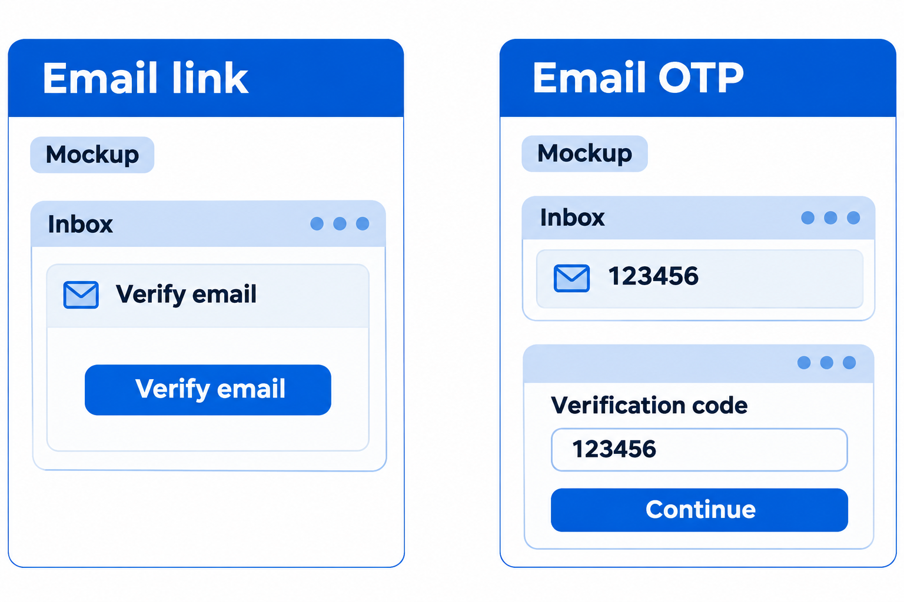

# User Manual Writer

**ไทย** · Agent Skill สำหรับเขียนคู่มือผู้ใช้และบทความคลังความรู้จากบันทึก ภาพหน้าจอ หรือระบบทดสอบที่ได้รับอนุญาต

**English** · An Agent Skill for writing end-user manuals and knowledge-base articles from notes, screenshots, or an authorized test system.

[ติดตั้ง / Install](#install) · [ใช้งาน / Use](#use) · [ตัวอย่าง / Example](#example)

<a id="install"></a>

## ติดตั้ง / Install

**ไทย** · ดาวน์โหลดหรือโคลนโครงการ แล้วคัดลอกทั้งโฟลเดอร์ [`skills/user-manual-writer`](skills/user-manual-writer/SKILL.md) ไปยังโฟลเดอร์สกิลของ Agent ที่ต้องการ เปิดเซสชันใหม่ในโครงการปลายทาง หากมีสกิลชื่อเดียวกันอยู่แล้ว ให้ตรวจและอัปเดตสำเนาเดิมเพื่อหลีกเลี่ยงรายการซ้ำ

**English** · Download or clone the repository, copy the entire [`skills/user-manual-writer`](skills/user-manual-writer/SKILL.md) folder into your agent’s skills directory, and start a new session in the target project. If you already have a skill with this name, review and update the existing copy to avoid duplicates.

| Agent | โฟลเดอร์ในโครงการ / Project directory | โฟลเดอร์ส่วนตัว / User directory |
| --- | --- | --- |
| [Codex](https://learn.chatgpt.com/docs/build-skills) | `.agents/skills/` | `~/.agents/skills/` |
| [Claude Code](https://code.claude.com/docs/en/skills) | `.claude/skills/` | `~/.claude/skills/` |
| [Gemini CLI](https://geminicli.com/docs/cli/skills/) | `.gemini/skills/` หรือ / or `.agents/skills/` | `~/.gemini/skills/` หรือ / or `~/.agents/skills/` |
| [GitHub Copilot CLI](https://docs.github.com/en/copilot/how-tos/copilot-cli/customize-copilot/add-skills) | `.github/skills/` หรือ / or `.agents/skills/` | `~/.copilot/skills/` |
| [GitHub Copilot in VS Code](https://code.visualstudio.com/docs/agent-customization/agent-skills) | `.github/skills/` หรือ / or `.agents/skills/` | ดูการตั้งค่า VS Code / See VS Code settings |
| [Cursor](https://cursor.com/docs/skills) | `.cursor/skills/` หรือ / or `.agents/skills/` | `~/.cursor/skills/` หรือ / or `~/.agents/skills/` |
| [OpenCode](https://opencode.ai/docs/skills/) | `.opencode/skills/` หรือ / or `.agents/skills/` | `~/.config/opencode/skills/` |

**ไทย** · ตัวอย่างต่อไปนี้ติดตั้งในขอบเขตโครงการด้วย `.agents/skills/` รันจากโฟลเดอร์ซอร์สชุดนี้ แล้วเปลี่ยนพาธปลายทางให้ตรงกับ Agent และโครงการของคุณ พาธที่ขึ้นต้นด้วย `~/` หมายถึงโฟลเดอร์ผู้ใช้ในเครื่องหรือสภาพแวดล้อมที่ Agent ทำงาน

**English** · The examples below install to a project’s `.agents/skills/` directory. Run them from this repository and adjust the destination for your agent and project. A path starting with `~/` is relative to the home directory in the environment where your agent runs.

**Windows · PowerShell**

```powershell
$dest = 'C:\path\to\project\.agents\skills'
if (Test-Path -LiteralPath (Join-Path $dest 'user-manual-writer')) {
    throw 'user-manual-writer is already installed at this destination'
}
New-Item -ItemType Directory -Path $dest -Force | Out-Null
Copy-Item -LiteralPath '.\skills\user-manual-writer' -Destination $dest -Recurse -ErrorAction Stop
```

**macOS / Linux / WSL · Shell**

```sh
dest='/path/to/project/.agents/skills'
if [ -e "$dest/user-manual-writer" ] || [ -L "$dest/user-manual-writer" ]; then
  printf '%s\n' 'user-manual-writer is already installed at this destination' >&2
else
  mkdir -p "$dest" && cp -R ./skills/user-manual-writer "$dest/"
fi
```

**Claude (web / desktop)**

**ไทย** · สร้าง ZIP ที่มี `user-manual-writer/SKILL.md` อยู่ในโฟลเดอร์ระดับแรก จากนั้นอัปโหลดที่ **Customize → Skills** หากบัญชีรองรับการอัปโหลด custom skill

**English** · Create a ZIP with `user-manual-writer/SKILL.md` in a top-level folder. Upload it under **Customize → Skills** when custom-skill uploads are enabled for your account. [Claude upload instructions](https://support.claude.com/en/articles/12512180-use-skills-in-claude)

```powershell
Compress-Archive -LiteralPath '.\skills\user-manual-writer' -DestinationPath '.\user-manual-writer.zip'
```

```sh
(cd skills && zip -r ../user-manual-writer.zip user-manual-writer)
```

**ไทย** · Agent อื่นที่รองรับมาตรฐานสามารถนำโฟลเดอร์สกิลไปติดตั้งตามเอกสารของแพลตฟอร์มนั้น แพลตฟอร์มที่รับเพียงคำสั่งในแชตสามารถแนบ `SKILL.md` แล้วขอให้ Agent ใช้เป็นแนวทางในเซสชันนั้นได้

**English** · For other compatible agents, use their documented install location or import procedure. On chat-only platforms, attach `SKILL.md` and ask the agent to follow it for the current session. [Agent Skills specification](https://agentskills.io/specification)

<a id="use"></a>

## ใช้งาน / Use

**ไทย** · ระบุชื่อสกิล ผู้ใช้เป้าหมาย งานที่ต้องการให้ทำ ภาษา และหลักฐานที่มี หากให้ URL ระบบทดสอบ ให้ระบุขอบเขตที่อนุญาตและวิธีเข้าด้วยบัญชีทดสอบที่ระบบรองรับ ส่งข้อมูลรับรองผ่านช่องทางที่ระบบกำหนด

**English** · Name the skill, audience, task, output language, and available evidence. If you provide a test URL, specify the permitted actions and how to access it with a supported test account. Use the system’s approved sign-in channel for credentials.

```text
ใช้ user-manual-writer เขียนคู่มือการยืนยันอีเมลสำหรับผู้ใช้ใหม่
จัดทำภาษาไทยและอังกฤษคู่กัน ใช้บันทึกขั้นตอนที่แนบ และระบุจุดที่ต้องถามเพิ่ม
```

```text
Use user-manual-writer to document email verification for first-time users.
Write Thai and English side by side. Use the attached notes and flag any missing steps.
```

| เงื่อนไข / Condition | พฤติกรรมของสกิล / Skill behavior |
| --- | --- |
| บันทึกหรือภาพที่แนบ / Attached notes or screenshots | เขียนตามหลักฐานและถามเมื่อข้อมูลสำคัญไม่ครบ / Draft from the evidence and ask about material gaps. |
| URL ระบบทดสอบที่ได้รับอนุญาต / Authorized test URL | ใช้ Browser เดินผ่าน UI จริงและจับภาพหน้าจอด้วย mock data / Use the agent’s browser to follow the real UI and capture screenshots with mock data. |
| ต้องล็อกอิน / Sign-in required | ใช้บัญชีทดสอบที่ระบบรองรับเท่านั้น หากไม่มี ให้แจ้งข้อจำกัดและถามวิธีเข้าด้วยบัญชีทดสอบ / Use a supported test account only. If none is available, report the blocker and ask for a supported test sign-in method. |
| ลิงก์ยืนยันหรือ OTP / Verification link or OTP | ใช้เครื่องมือสร้างภาพของ Agent ทำภาพจำลองโดยใช้ข้อมูลสมมติ / Use the agent’s image-generation tool to illustrate the step with fictional data. |

**ไทย** · ความสามารถของ Browser การจับภาพ และการสร้างภาพขึ้นกับเครื่องมือ สิทธิ์ และการเข้าถึงเครือข่ายของ Agent แต่ละตัว หากเครื่องมือขาดหรือใช้ไม่ได้ สกิลจะรายงานส่วนที่ตรวจหรือสร้างภาพไม่ได้ แล้วขอหลักฐานหรือระบุจุดวางภาพตามกรณี

**English** · Browser access, screenshot capture, and image generation depend on the host agent’s tools, permissions, and network access. If a capability is unavailable, the skill reports the limitation and asks for evidence or marks the image placement where appropriate.

<a id="example"></a>

## ตัวอย่างคู่มือ / Sample manual

ตัวอย่างนี้ใช้ระบบสมมติเพื่อแสดงรูปแบบคู่มือ / This sample uses a fictional system to demonstrate the manual format.

| หัวข้อ | ไทย | English |
| --- | --- | --- |
| ชื่อฟีเจอร์ / Feature | ยืนยันอีเมล | Verify your email |
| วัตถุประสงค์ / Objective | ยืนยันว่าคุณเข้าถึงอีเมลที่ใช้สมัครได้ | Confirm that you can access the email address you signed up with. |
| กลุ่มผู้ใช้ / Audience | ผู้ใช้ใหม่ที่ได้รับแจ้งให้ยืนยันอีเมล | New users prompted to verify their email. |
| สิ่งที่ต้องเตรียม / Prerequisites | เปิดกล่องจดหมายของบัญชีตัวอย่าง | Open the inbox for the demo account. |
| **Step 1** | เปิดอีเมลยืนยันที่ระบบส่งให้ | Open the verification email sent by the system. |
| **Step 2** | หากได้รับลิงก์ ให้คลิก **Verify email** หากได้รับรหัส ให้กรอกใน **Verification code** แล้วคลิก **Continue** | If you received a link, select **Verify email**. If you received a code, enter it in **Verification code** and select **Continue**. |
| **Step 3** | ตรวจว่าหน้าจอแสดงสถานะ **Email verified** | Check that the page shows **Email verified**. |
| ปัญหาที่พบบ่อย / Troubleshooting | หากไม่พบอีเมล ให้ตรวจกล่องจดหมายขยะและตรวจอีเมลที่ใช้สมัคร | If the message is missing, check your spam folder and confirm your sign-up address. |



*ภาพจำลองจาก AI สำหรับตัวอย่าง / AI-generated mockup for this example.* ปุ่มและรหัสในภาพเป็นข้อมูลสมมติ / The buttons and code are fictional.

<!-- Image provenance: built-in AI image generation.
Prompt: Design a wide 3:2 documentation image containing two independent examples in separate adjacent blue-and-white cards with a wide empty vertical gutter. IMPORTANT there is absolutely no arrow, line, numbering, motion or visual connection between the two cards: they are two different verification methods. Left card: title 'Email link', small label 'Mockup', illustrated single sample inbox message with plain non-interactive button 'Verify email'. Right card: title 'Email OTP', small label 'Mockup', sample inbox code '123456', and directly below it a small app window containing a 'Verification code' field prefilled with '123456' and a 'Continue' button. Exact readable text with no additional body copy. White background, dark navy text, blue accents, high contrast, minimal clean fictional interface. No email addresses, URLs, real credentials, logos, or watermarks.
-->

## ซอร์สและสัญญาอนุญาต / Source and license

**ไทย** · ซอร์สที่ติดตั้งได้อยู่ใน `skills/user-manual-writer/` ส่วน `assets/` เก็บภาพสำหรับ README

**English** · The installable source lives in `skills/user-manual-writer/`. The `assets/` directory contains README artwork.

[MIT License](LICENSE)
